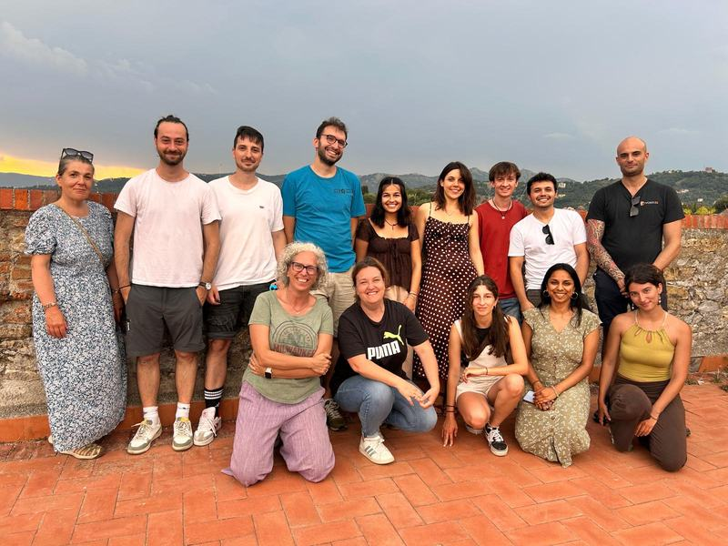

# Machine Learning & Vision · MLV

**[MaLGa](https://malga.unige.it/) — University of Genoa**

The **Machine Learning & Vision (MLV)** unit develops machine learning and artificial intelligence methods for understanding visual, biomedical, and multimodal data. Our goal is to design computational models that learn meaningful and transferable representations from complex data, enabling robust perception, reasoning, and decision-making in challenging environments.

For more details on our research, visit [malga.unige.it/research/mlv](https://malga.unige.it/research/mlv).

## 👥 People

- Gabriele Bortolai
- Massimiliano Ciranni
- Khan Dadan
- Jacopo Dapueto
- Roberto Di Via
- Matteo Ferrari
- Maria Clara Giaccaglia
- Ani Gjergji
- Matteo Moro
- Nicoletta Noceti
- Francesca Odone
- Stefano Passaggio
- Vito Paolo Pastore
- Manasa Pawar
- Bianca Perasso
- Veronica Pignedoli
- Xiaolin Xing

## 📂 Code

Our publicly available code and datasets can be explored in the [repositories of this organization](https://github.com/orgs/Malga-Vision/repositories).
